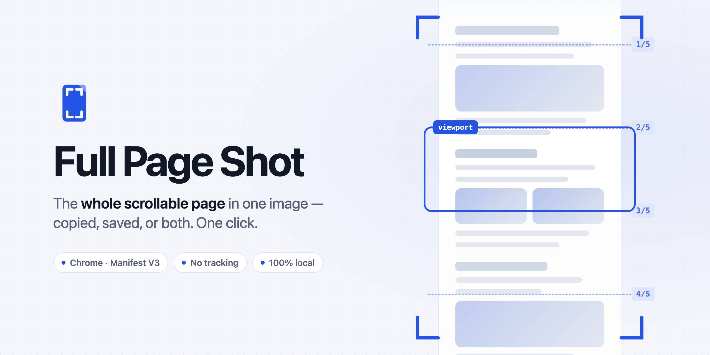
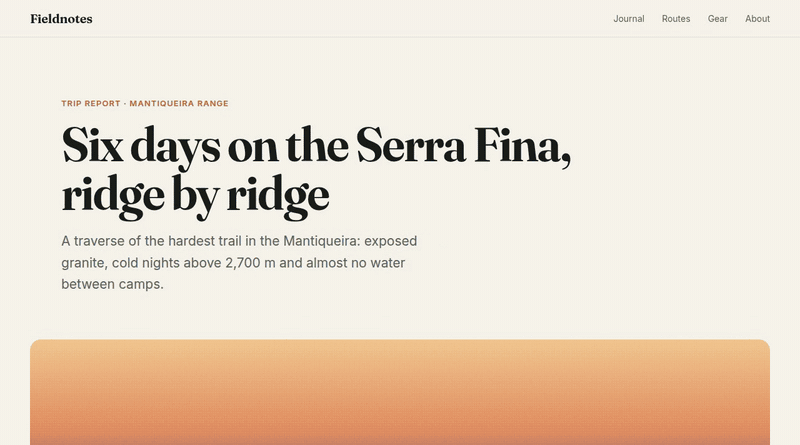
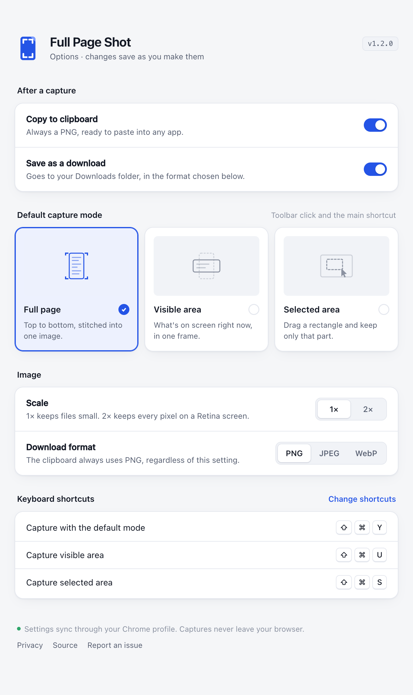
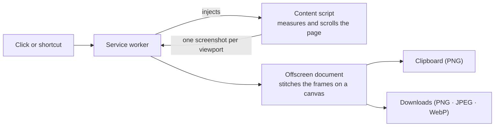

<picture>
  <source media="(prefers-color-scheme: dark)" srcset="docs/assets/banner-dark.png">
  
</picture>

<p align="center">
  <a href="https://github.com/raniellimontagna/full-page-shot/actions/workflows/ci.yml"></a>
  <a href="https://codecov.io/gh/raniellimontagna/full-page-shot"></a>
  
  
  <a href="LICENSE"></a>
</p>

<p align="center">
  A Chrome extension that captures the <b>entire scrollable page</b> — not just what fits on screen —<br>
  and hands you one image: on your clipboard, in your Downloads folder, or both.
</p>

<p align="center">
  
</p>

## Features

- **Three capture modes.** The full page, just the visible area, or a region you drag out with the mouse.
- **One click or one shortcut.** The toolbar button runs your default mode; each mode also has its own shortcut and a right-click menu entry.
- **Clipboard, download, or both.** The clipboard always gets a PNG that pastes anywhere. Downloads can be PNG, JPEG or WebP, at 1× or 2×.
- **Fixed headers show up once.** Sticky navbars and floating buttons are hidden after the first frame, so they don't repeat down the image.
- **The page is left as it was.** Scroll position and hidden elements are restored when the capture ends, even if it fails halfway.
- **No "DevTools is debugging this tab" banner.** The extension scrolls and stitches instead of attaching `chrome.debugger` ([why](docs/DEVELOPMENT.md#why-scroll-and-stitch-not-chromedebugger)).
- **Private by design.** No network requests, no analytics, no account. The extension can only touch the tab you click it on.

## Install

Full Page Shot is not on the Chrome Web Store yet. To install it from source (Chrome 116 or newer):

```bash
git clone https://github.com/raniellimontagna/full-page-shot.git
cd full-page-shot
pnpm install
pnpm build
```

Then open `chrome://extensions`, turn on **Developer mode**, click **Load unpacked** and pick the `dist/` folder. Pin the icon to the toolbar so it is one click away.

## Usage

| Mode | What you get | Shortcut (Windows / Linux) | Shortcut (macOS) |
|---|---|---|---|
| Full page | The whole document, top to bottom, stitched from several frames | `Ctrl+Shift+Y` ¹ | `⇧⌘Y` ¹ |
| Visible area | One frame of what is on screen right now | `Ctrl+Shift+U` | `⇧⌘U` |
| Selected area | Only the rectangle you drag over the screen | `Ctrl+Shift+S` | `⇧⌘S` |

¹ The toolbar click and this shortcut run whichever mode you set as the default (full page out of the box). Right-click the toolbar icon to pick a mode for a single capture.

The shortcuts are suggestions: if another extension already took one, Chrome leaves it unassigned. The options page shows what is actually bound, and you can change any of them at `chrome://extensions/shortcuts`.

**Selecting an area.** The page dims; drag a rectangle and release. Press <kbd>Esc</kbd>, click without dragging, or draw something tiny to call it off — a grey `·` flashes on the icon and nothing is copied or saved. A selection covers what is on screen only; use full-page mode for anything below the fold.

**Feedback.** The toolbar icon shows a green `✓` when a capture is delivered and a red `✕` when it fails. Downloads are named after the site and the time, with a `-viewport` or `-selection` suffix for those modes.

## Options

<picture>
  <source media="(prefers-color-scheme: dark)" srcset="docs/assets/options-dark.png">
  
</picture>

Right-click the toolbar icon → **Options** to choose where captures go, the default mode, the scale and the download format. Changes save as you make them and follow your Chrome profile through sync.

## How it works



The service worker measures the page, then scrolls it one viewport at a time and grabs each frame with `chrome.tabs.captureVisibleTab`. An offscreen document draws the frames onto a single canvas, scales it to the size you chose and encodes it. Everything happens inside your browser.

## Privacy

Full Page Shot collects nothing and sends nothing anywhere. It has no analytics and makes no network requests. The only data it keeps is your own preferences, in Chrome's settings sync. Read the full [privacy policy](docs/store/privacy-policy.md).

| Permission | Why it is needed |
|---|---|
| `activeTab` | Access to the current tab, only after you click the icon or press a shortcut. No standing access to any site. |
| `scripting` | Injects the script that measures and scrolls the page you are capturing. |
| `offscreen` | Service workers have no canvas; the frames are stitched in an offscreen document. |
| `downloads` | Saves the image to your Downloads folder, when that output is on. |
| `clipboardWrite` | Copies the image to your clipboard, when that output is on. |
| `storage` | Remembers your preferences. |
| `contextMenus` | Adds the mode picker to the toolbar icon's right-click menu. |

## Limitations

- Pages that scroll an inner container instead of the document (some single-page apps) capture only the visible area.
- Chrome's own pages (`chrome://`, the Web Store) cannot be captured — Chrome blocks every extension there.
- On displays scaled to 125%, 150% or 175%, seams can drift by a few pixels on very long pages.

The details, and one more edge case for extremely tall pages, are in [docs/DEVELOPMENT.md](docs/DEVELOPMENT.md#known-limitations-in-detail).

## Development

```bash
pnpm install
pnpm dev          # rebuild into dist/ on every change
pnpm test         # unit tests (Vitest)
pnpm test:e2e     # end-to-end tests in a real Chromium (Playwright)
```

Project layout, test layers, CI and the design spec are covered in [docs/DEVELOPMENT.md](docs/DEVELOPMENT.md).

## License

[ISC](LICENSE) © Ranielli Montagna
